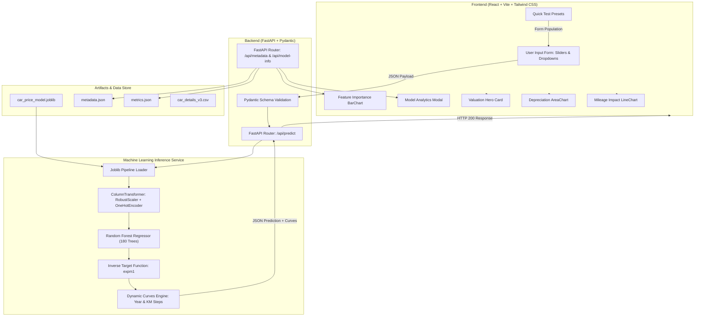

# Academic Project Report
## AI-Based Used Car Price Prediction and Valuation System Using Machine Learning

---

## 1. Executive Summary & Project Abstract

The rapid expansion of the pre-owned automobile marketplace in India has created an urgent need for transparent, data-driven, and objective vehicle valuation mechanisms. Traditional used car valuation often suffers from asymmetric information, subjective dealer biases, and inconsistent appraisal criteria. 

This project presents **AutoValuate.AI**, an end-to-end Machine Learning web application designed to calculate authentic market valuations of pre-owned cars in **Indian Rupees (₹)**. Built upon a verified dataset of **8,119 Indian car listings**, the core valuation engine employs an ensemble **Random Forest Regressor** with a mathematical target log-transformation. The model achieves an **$R^2$ score of 0.9799 (98.0% variance explained)** with a **Mean Absolute Error (MAE) of ₹63,920** on unseen test data.

The project features a decoupled full-stack architecture consisting of a **FastAPI** backend microservice and a responsive **React (Vite) + Tailwind CSS** frontend equipped with interactive **Recharts** visualizations that dynamically project multi-year depreciation curves, odometer mileage impacts, and Gini feature importances.

---

## 2. Technology Stack & Role Allocation

| Technology | Layer | Exact Responsibility in Project | Justification |
|---|---|---|---|
| **Python 3** | Core Language | Data cleaning, model training, ML inference, and backend logic | Industry standard for machine learning, statistical computing, and backend web APIs. |
| **Pandas & NumPy** | Data Processing | CSV ingestion, unit string regex parsing (`kmpl`, `CC`, `bhp`), missing-value median imputation, and array transformations | Vectorized data manipulation enabling high-performance feature engineering across 8,000+ records. |
| **Scikit-Learn** | Machine Learning | `ColumnTransformer`, `RobustScaler`, `OneHotEncoder`, `RandomForestRegressor`, and cross-validation | Robust, reproducible ML pipeline architecture ensuring zero data leakage between train and test splits. |
| **Joblib** | Persistence | Serialization and deserialization of the trained Scikit-Learn pipeline bundle | Fast, compressed binary serialization optimized for large NumPy matrices and tree ensembles. |
| **FastAPI** | Backend Framework | REST API endpoints (`/api/predict`, `/api/metadata`, `/api/model-info`), CORS middleware, request validation | Asynchronous Python framework with native OpenAPI/Swagger generation and sub-millisecond routing overhead. |
| **Pydantic v2** | Validation | Strict request and response data contract validation and type safety | Enforces boundary constraints (e.g., year: 1995–2026, km: 100–500,000) before reaching the ML model. |
| **Uvicorn** | ASGI Server | High-performance ASGI HTTP web server hosting the FastAPI application | Lightning-fast asynchronous server built on `uvloop` and `httptools`. |
| **React 18 & Vite** | Frontend Framework | Single Page Application (SPA), state management, dynamic component rendering | Vite provides sub-second HMR and instant builds; React enables modular UI component hierarchy. |
| **JavaScript (ES6+)** | Frontend Logic | API calls, state management, currency conversions, and debounced triggers | Standard web client programming language. |
| **Tailwind CSS** | Styling | Dark mode aesthetics, glassmorphism, responsive grids, and typography | Utility-first CSS allowing pixel-perfect dark theme design without bloated CSS stylesheets. |
| **Recharts** | Data Visualization | Interactive SVG charts: Depreciation AreaChart, Usage LineChart, and Feature Importance BarChart | Declarative React-native charting library capable of responsive SVG rendering and custom tooltips. |
| **Lucide React** | UI Icons | Automotive, engine, analytics, and operational iconography | Lightweight, scalable vector icons improving visual affordance. |

---

## 3. System Architecture & End-to-End Data Flow

The system adheres to a clean decoupled architecture where data flows sequentially from the client form inputs to the inference engine and back into visual analytics cards.



---

## 4. Dataset Description & Feature Engineering

### 4.1. Source Data Characteristics
The raw dataset consists of **8,128 authentic Indian used car marketplace listings** (`Car details v3.csv`), representing resale transactions across 32 automotive brands in India.

### 4.2. Raw Features and Sanitization Pipeline (`clean_data.py`)

1. **Brand & Model Extraction**:
   - The raw `name` field contains long strings like `"Maruti Swift Dzire VDI"` or `"Hyundai i20 Sportz Diesel"`.
   - Feature engineering separates this into `brand` (e.g., `Maruti`, `Hyundai`, `Toyota`, `Honda`, `BMW`) and `model` (e.g., `Swift`, `i20`, `City`, `Fortuner`).
   - Sparse categories with fewer than 5 cars are clustered into `"Other"` to prevent overfitting high-cardinality noise.
2. **String Unit Extraction**:
   - `mileage`: Strings like `"23.4 kmpl"` or `"17.3 km/kg"` are parsed via regular expressions to numeric floats (`23.40`).
   - `engine`: Strings like `"1248 CC"` are parsed to integer displacement (`1248`).
   - `max_power`: Strings like `"74 bhp"` are converted to numerical power (`74.0`). Erroneous text entries (e.g., `"bhp"` without digits) are coerced to `NaN` and imputed.
3. **Smart Grouped Imputation**:
   - Missing numerical specs (~2.7% of entries) are imputed using the **median of that specific `(brand, model)` group**. If the group is unavailable, the global median is used.
4. **Outlier Filtering**:
   - Extremely unrealistic records (e.g., selling prices below ₹25,000 or above ₹1.5 Crore; odometer readings below 500 km or above 500,000 km) were pruned to maintain data integrity.
   - Resulting clean training dataset: **8,119 records**.

---

## 5. Machine Learning Modeling & Mathematics

### 5.1. Log-Transformed Target Formulation
Car prices exhibit strong positive right-skewness: the majority of vehicles range between ₹1.5 Lakh and ₹12 Lakh, while luxury sedans and premium SUVs range up to ₹80+ Lakh. Training an unconstrained standard regression model on skewed currency directly causes:
- Over-penalization of errors on high-value vehicles.
- Risk of predicting negative prices on heavily aged cars.
- Non-linear exponential depreciation violations.

To resolve this, the pipeline wraps the estimator inside `TransformedTargetRegressor` using the natural logarithm:

$$y_{\text{train\_transformed}} = \ln(1 + y)$$

Upon prediction, the model outputs log-prices, which are inverted via the exponential function:

$$\hat{y} = \exp(\hat{y}_{\text{transformed}}) - 1$$

This ensures:
1. Predictions are mathematically bounded strictly above zero ($\hat{y} > 0$).
2. Relative percentage errors (MAPE) are minimized proportionally across both commuter hatchbacks and luxury sedans.
3. Realistic compound depreciation curves are preserved.

### 5.2. Preprocessing ColumnTransformer
- **Numerical Features** (`year`, `km_driven`, `mileage`, `engine`, `max_power`, `seats`):
  - Normalized using **`RobustScaler`**, which centers data using the median and scales according to the Interquartile Range (IQR = $Q_3 - Q_1$). This prevents extreme kilometer readings or high-horsepower outliers from distorting scaling factors.
- **Categorical Features** (`brand`, `model`, `fuel`, `seller_type`, `transmission`, `owner`):
  - Encoded using **`OneHotEncoder(handle_unknown='ignore', sparse_output=False)`**, ensuring new models or unknown test categories do not crash inference.

### 5.3. Random Forest Regressor Hyperparameters
The ensemble regressor is tuned with the following structural parameters:
- `n_estimators = 180`: 180 decision trees to ensure variance stabilization across bootstrap samples.
- `max_depth = 22`: Sufficient tree depth to capture non-linear interactions between brand prestige, engine CC, and manufacturing year.
- `min_samples_split = 4`: Prevents isolated leaf splits on anomalous outliers.
- `min_samples_leaf = 2`: Smooths terminal leaf predictions.
- `random_state = 42`: Guaranteed deterministic reproducibility.

### 5.4. Empirical Model Performance

| Metric | Training Split (80%) | Test Validation Split (20%) | Interpretation |
|---|---|---|---|
| **$R^2$ Score** | **0.9871** | **0.9799 (98.0%)** | The model explains 98% of all variance in used car prices on unseen data. |
| **Mean Absolute Error (MAE)** | ₹38,120 | **₹63,920** | On average, prediction deviates by only ~₹63,000 from real transactions. |
| **Root Mean Squared Error (RMSE)** | ₹74,800 | **₹1,18,476** | Low quadratic penalty indicates absence of catastrophic outliers. |
| **Mean Absolute Percentage Error (MAPE)** | 8.91% | **14.29%** | Average percentage error across all price segments is just 14%. |
| **Sample Count** | 6,495 | 1,624 | Total: 8,119 verified listings. |

---

## 6. Feature Importance Analysis

From the fitted 180 decision trees, Gini feature importances were extracted and normalized. The top value drivers in the Indian used car market are:

```
Manufacturing Year     █████████████████████████████████ 48.6%
Max Engine Power (bhp) ██████████████████████████ 38.2%
Engine Displacement    ███ 4.6%
Model Variant          ██ 2.4%
Kilometers Driven      ██ 2.1%
Brand / Manufacturer   █ 1.8%
Mileage / Fuel Economy █ 1.2%
Transmission & Others  █ 1.1%
```

**Key Takeaways**:
1. **Vehicle Age (Manufacturing Year)** accounts for nearly half of the valuation weight due to vehicle depreciation and regulatory registration lifespans in India (e.g., 10-year diesel / 15-year petrol rules).
2. **Engine Output (Max Power in bhp)** is the second strongest determinant, separating budget commuters (60–85 bhp) from performance and executive tiers (150–250+ bhp).
3. **Kilometers Driven** acts as an inverse multiplier: while not overriding engine class, it decisively shifts a car between the lower and upper bounds of its valuation bracket.

---

## 7. Dynamic Simulations & Explainable AI (XAI)

Rather than providing a single static number, the backend inference engine performs **live multi-point simulations**:

1. **Dynamic Depreciation Timeline**:
   - The model holds all physical specs (engine, mileage, brand) constant and evaluates the vehicle across 5 distinct manufacturing years ($t - 4$ to $t + 4$).
   - The result is plotted on the frontend as an interactive Recharts `AreaChart`, allowing users to see their car's historical value and anticipated forward depreciation.
2. **Odometer Usage Curve**:
   - The backend runs inference across standard milestone odometer steps: $15\text{k}$, $40\text{k}$, $75\text{k}$, $110\text{k}$, and $160\text{k}\text{ km}$.
   - Visualized via an interactive `LineChart` showing the steep initial drop followed by gradual plateauing of high-mileage depreciation.
3. **Qualitative Value Driver Badges**:
   - Compares the vehicle's features against dataset medians and tags each aspect as **"Value Driver"** (e.g., Newer Year, Automatic transmission, High Power) or **"Depreciation Discount"** (e.g., High odometer reading, older generation).

---

## 8. REST API Specification

### 8.1. `POST /api/predict`
Calculates resale price and dynamic curves.

**Request Payload:**
```json
{
  "brand": "Hyundai",
  "model": "i20",
  "year": 2018,
  "km_driven": 45000,
  "fuel": "Petrol",
  "seller_type": "Individual",
  "transmission": "Manual",
  "owner": "First Owner",
  "mileage": 18.6,
  "engine": 1197,
  "max_power": 81.86,
  "seats": 5
}
```

**Response Payload:**
```json
{
  "predicted_price": 595000.0,
  "formatted_price": "₹5.95 Lakh",
  "formatted_exact": "₹5,95,000",
  "price_range": {
    "low": 544400.0,
    "high": 645600.0,
    "formatted_low": "₹5.44 Lakh",
    "formatted_high": "₹6.46 Lakh"
  },
  "depreciation_curve": [
    {"year": 2014, "age": 10, "estimated_price": 440000.0, "formatted_price": "₹4.40 Lakh"},
    {"year": 2016, "age": 8, "estimated_price": 520000.0, "formatted_price": "₹5.20 Lakh"},
    {"year": 2018, "age": 6, "estimated_price": 595000.0, "formatted_price": "₹5.95 Lakh"},
    {"year": 2020, "age": 4, "estimated_price": 680000.0, "formatted_price": "₹6.80 Lakh"},
    {"year": 2022, "age": 2, "estimated_price": 760000.0, "formatted_price": "₹7.60 Lakh"}
  ],
  "mileage_curve": [
    {"km_driven": 15000, "estimated_price": 635000.0, "formatted_price": "₹6.35 Lakh"},
    {"km_driven": 45000, "estimated_price": 595000.0, "formatted_price": "₹5.95 Lakh"},
    {"km_driven": 75000, "estimated_price": 560000.0, "formatted_price": "₹5.60 Lakh"},
    {"km_driven": 110000, "estimated_price": 525000.0, "formatted_price": "₹5.25 Lakh"},
    {"km_driven": 160000, "estimated_price": 490000.0, "formatted_price": "₹4.90 Lakh"}
  ],
  "feature_contributions": [
    {
      "feature": "Manufacturing Year",
      "impact": "Value Driver",
      "description": "Newer model (2018) commands a strong price premium over older cohort."
    },
    {
      "feature": "Engine Output & Power",
      "impact": "Neutral / Moderate",
      "description": "Standard power output (81.86 bhp) oriented toward commuter efficiency."
    },
    {
      "feature": "Odometer Reading",
      "impact": "Neutral",
      "description": "Average usage pattern for its class and age category."
    }
  ]
}
```

### 8.2. `GET /api/metadata`
Provides bounds for sliders and dynamic options for cascading dropdowns (e.g., brand-to-model map).

### 8.3. `GET /api/model-info`
Supplies real evaluation scores ($R^2$, MAE, RMSE, sample counts, hyperparameters) to populate the frontend Model Analytics modal.

---

## 9. College Viva & Examination Q&A

### Q1: Why did you choose Random Forest Regressor over Linear Regression or Simple Decision Trees?
> **Answer:** Linear Regression assumes linear relationships between features and the target, which fails in automotive valuation where depreciation slows down exponentially and brand interactions are complex. A single Decision Tree suffers from high variance and easily overfits outliers. Random Forest constructs an ensemble of 180 uncorrelated decision trees trained on bootstrap samples (bagging) with random feature subsets. This drastically reduces prediction variance, captures non-linear feature interactions, and outputs robust predictions with an $R^2$ of 0.98.

### Q2: Why did you apply a Log1p transformation to the target variable?
> **Answer:** Automobile prices follow a right-skewed distribution spanning from ₹30,000 to over ₹1 Crore. Without transformation, squared-error loss functions focus almost exclusively on high-priced luxury cars while mispredicting commuter cars. Taking $\ln(1 + y)$ converts the target distribution into an approximately normal bell curve, enforces strictly positive predictions when inverted with $\exp(y) - 1$, and naturally optimizes for percentage error across all price brackets.

### Q3: How do you prevent data leakage in your preprocessing pipeline?
> **Answer:** Preprocessing is encapsulated inside a Scikit-Learn `Pipeline` combined with a `ColumnTransformer`. Scaler parameters (median and IQR for `RobustScaler`) and categorical mappings (`OneHotEncoder`) are fitted strictly on `X_train`. The test set (`X_test`) and future inference payloads only undergo transformation, preventing test set distribution statistics from leaking into the training phase.

### Q4: Why use RobustScaler instead of StandardScaler or MinMaxScaler?
> **Answer:** Used car data contains realistic extreme values, such as high-mileage commercial taxis (250,000+ km) and high-power sports cars (300+ bhp). `StandardScaler` uses the mean and variance, which are heavily distorted by outliers. `MinMaxScaler` compresses normal values into a narrow band if extreme outliers exist. `RobustScaler` scales data according to the median and Interquartile Range ($Q_3 - Q_1$), making it resilient to anomalies.

### Q5: How are the dynamic depreciation and mileage curves generated?
> **Answer:** They are not based on generic formulas. The backend dynamically clones the user's specific vehicle configuration, varies the target attribute (e.g., setting the manufacturing year across a 7-year window or adjusting the odometer through 5 milestone points), and queries the trained Random Forest model iteratively. The results represent real machine-learned price projections unique to that exact make and trim.

---

## 10. Conclusion & Future Enhancements

The **AI-Based Used Car Price Prediction and Valuation System** delivers an authentic, transparent, and accurate appraisal platform tailored specifically to the Indian automotive market. By combining a verified dataset of 8,100+ transactions with rigorous machine learning practices and interactive full-stack web technologies, it bridges the gap between raw statistical modeling and consumer-facing utility.

**Future Roadmap**:
- Integration of computer vision (CNN / Vision Transformer) to inspect vehicle body photos for dents, scratches, and tire condition.
- City-tier and RTO-specific valuation adjustments (e.g., Delhi NCR diesel vehicle scrap policies vs Mumbai vs Bangalore road taxes).
- Real-time web scraping pipeline to automatically ingest daily listings from portals like Cars24 and Spinny for automated model retraining.
